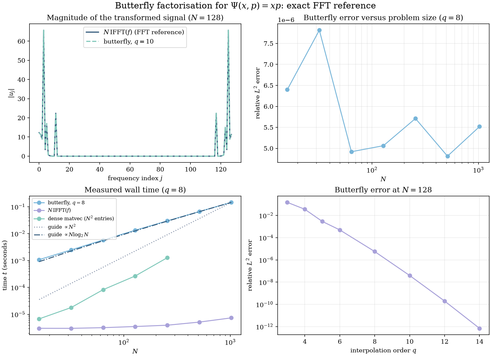

# Butterfly factorisation versus FFT: $\Psi(x,p)=xp$

A minimal one-dimensional demonstration of the centred-residual butterfly
algorithm for the positive-sign discrete Fourier transform (DFT).

$$
\begin{equation*}
u_i=\sum_{j=0}^{N-1}f_j e^{2\pi i\,ij/N},\qquad i=0,\ldots,N-1.
\end{equation*}
$$

On $x_i=i/N$ and $p_j=j/N$, the kernel is $e^{2\pi iN\Psi(x_i,p_j)}$ with
$\Psi(x,p)=xp$. The exact reference is

$$
\begin{equation*}
u=N\,\operatorname{IFFT}(f).
\end{equation*}
$$

The FFT and the butterfly algorithm compute the same transform. This is a
verification example, not a claim that butterfly should beat the highly
specialised FFT. The construction matters because it extends to more general
Fourier integral operators that do not have a global FFT diagonalisation.

## Files

- `butterfly.py`: the general phase-based butterfly, the DFT case, and dense references.
- `test_butterfly.py`: correctness and convergence tests.
- `compare.py`: error/timing measurements, CSV files, and a four-panel figure.
- `results/`: generated DFT/non-DFT measurements, visualisations, and result tables.

Only NumPy is needed for the algorithm. Matplotlib is used for the figure.

## Run

```bash
python -m pip install -r requirements.txt
python test_butterfly.py
python compare.py
```

`N=len(f)` must be a power of two. Choose interpolation order with `q`:

```python
import numpy as np
from butterfly import butterfly_dft, fft_dft

f = np.random.default_rng(0).normal(size=128)
exact = fft_dft(f)
approximate = butterfly_dft(f, q=10)
relative_error = np.linalg.norm(approximate-exact) / np.linalg.norm(exact)
print(relative_error)

# A non-DFT oscillatory kernel, with a dense reference.
from butterfly import butterfly_fio, dense_fio
phase = lambda x, p, n: n * (x*p + 0.1*x**2*p**2)
exact_non_dft = dense_fio(f, phase)
approximate_non_dft = butterfly_fio(f, q=10, phase=phase)
print(np.linalg.norm(approximate_non_dft-exact_non_dft) /
      np.linalg.norm(exact_non_dft))
```

## Algorithm in one paragraph

At level $\ell$, observation boxes have width $h_\ell=2^{-\ell}$ and source
boxes have width $H_\ell=2^\ell/N$. Hence $Nh_\ell H_\ell=1$. On each
rectangle with centres $(a,b)$, the phase satisfies the exact identity

$$
\begin{equation*}
e^{2\pi iNxp}=e^{2\pi iNxb}e^{2\pi iNap}e^{-2\pi iNab}
 e^{2\pi iN(x-a)(p-b)}.
\end{equation*}
$$

Only the last factor couples $x$ and $p$, and its phase is bounded by $\pi/2$
at the corners. The implementation interpolates this residual exponential at
$q$ Chebyshev--Lobatto nodes and transfers the short coefficient vectors from
level to level. No $N\times N$ kernel matrix is formed.

Each level has $N$ complementary pairs and there are $\log_2N+1$ levels.
For fixed $q$ this gives $O(N\log_2N)$ paired updates; the corresponding
scalar work is $O(q^2N\log_2N)$, compared with $N^2$ entries in the dense
transform. Approximation errors are compared directly with the FFT; no
global error theorem is asserted by this demonstration.

See [the measured results](results/README.md) and
.

## Reference

E. J. Candès, L. Demanet, and L. Ying,
[A Fast Butterfly Algorithm for the Computation of Fourier Integral Operators](https://arxiv.org/abs/0809.0719).
