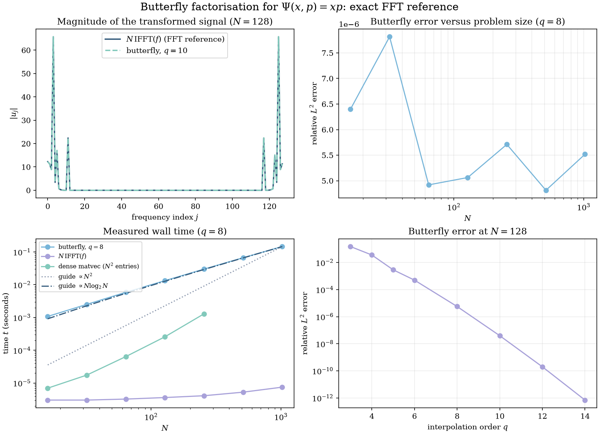
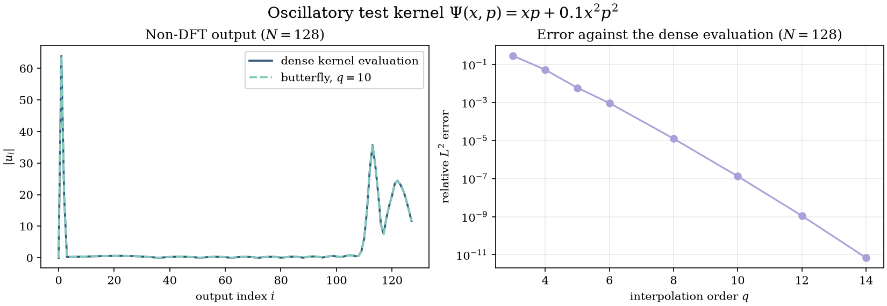

# Measured results

DFT errors use the positive-sign FFT; non-DFT errors use a dense kernel evaluation.
Absolute timing values depend on the machine; rerun `python compare.py` to reproduce them.
Timings use one BLAS thread and an explicit warm-up for the dense path.

## Scaling at q=8

| N | relative L2 error | butterfly (s) | FFT (s) | dense matvec (s) | pairs |
|---:|---:|---:|---:|---:|---:|
| 16 | 6.399e-06 | 1.077e-03 | 3.014e-06 | 6.963e-06 | 80 |
| 32 | 7.816e-06 | 2.509e-03 | 3.014e-06 | 1.746e-05 | 192 |
| 64 | 4.919e-06 | 5.873e-03 | 3.234e-06 | 6.416e-05 | 448 |
| 128 | 5.063e-06 | 1.329e-02 | 3.602e-06 | 2.577e-04 | 1024 |
| 256 | 5.711e-06 | 2.993e-02 | 4.094e-06 | 1.295e-03 | 2304 |
| 512 | 4.813e-06 | 6.665e-02 | 5.256e-06 | not run | 5120 |
| 1024 | 5.518e-06 | 1.459e-01 | 7.476e-06 | not run | 11264 |

The FFT is much faster in wall time because it is an optimised specialised
implementation of this exact transform. The useful check here is scaling:
the butterfly has O(N log N) paired coefficient updates, whereas a dense
matrix has N^2 entries. Python loop overhead is not representative of an
optimised implementation.

## Accuracy at N=128

| q | relative L2 error |
|---:|---:|
| 3 | 1.506e-01 |
| 4 | 3.609e-02 |
| 5 | 2.905e-03 |
| 6 | 5.009e-04 |
| 8 | 5.652e-06 |
| 10 | 3.950e-08 |
| 12 | 1.983e-10 |
| 14 | 6.920e-13 |

Here relative $L^2$ error means $||u_q-u_{reference}||_2/||u_{reference}||_2$.

## Non-DFT oscillatory kernel

The phase is $\Psi(x,p)=xp+0.1x^2p^2$ at $N=128$. The reference is the
explicit dense evaluation of the same kernel, not an FFT.

| q | relative L2 error |
|---:|---:|
| 3 | 2.785e-01 |
| 4 | 5.228e-02 |
| 5 | 5.838e-03 |
| 6 | 9.271e-04 |
| 8 | 1.256e-05 |
| 10 | 1.324e-07 |
| 12 | 1.116e-09 |
| 14 | 6.879e-12 |

